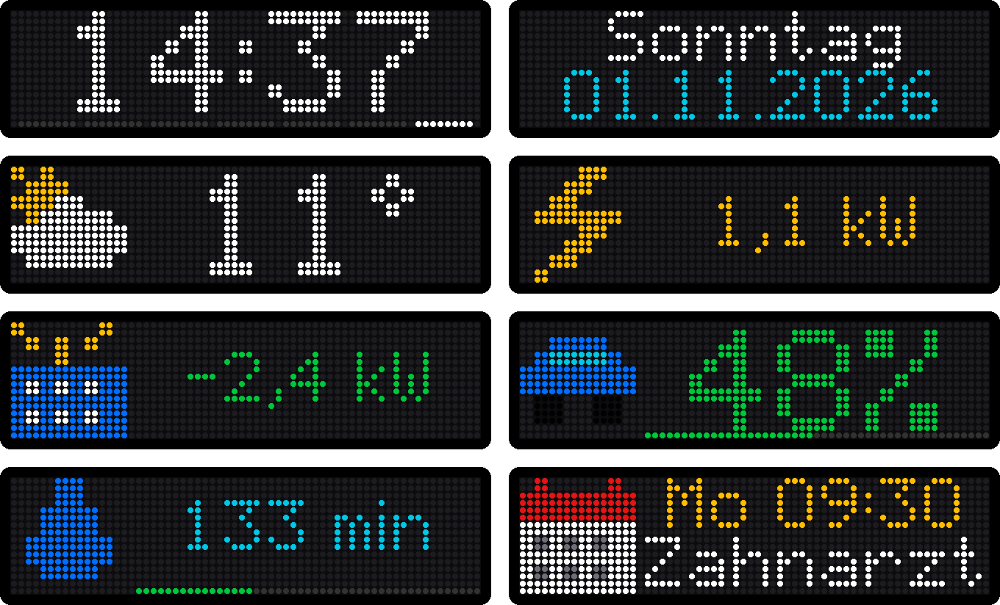
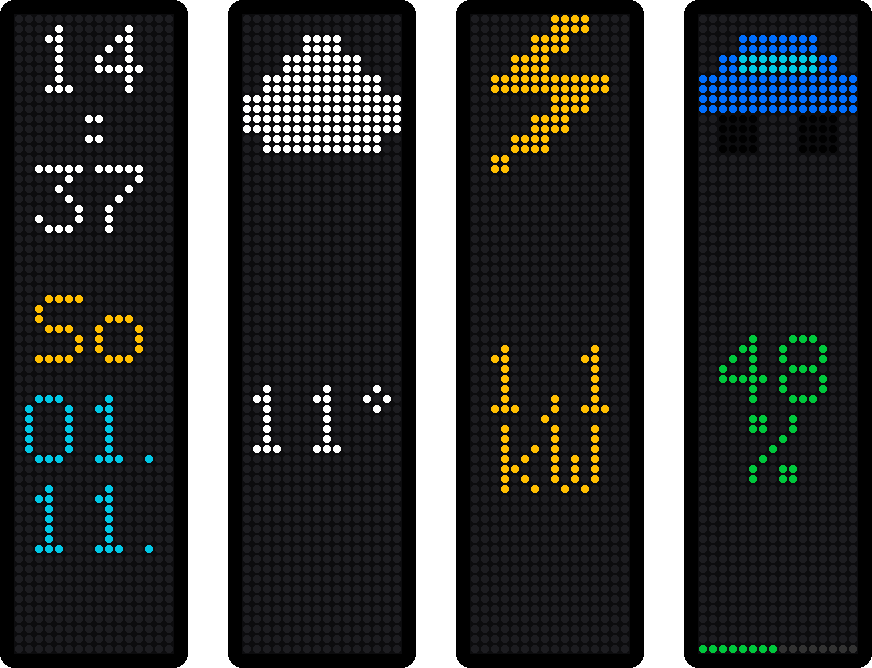
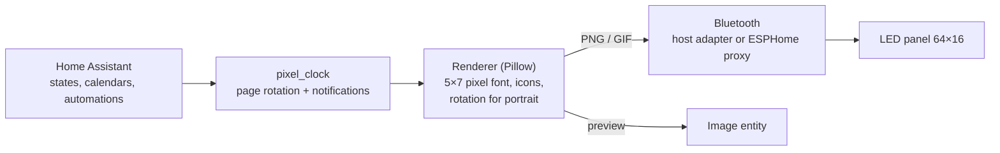

# Pixel Clock for Home Assistant

<p align="center"></p>

Turns a cheap **iPixel Color** Bluetooth LED panel into a smart home display, similar to an
AWTRIX / Ulanzi clock: time, date, weather, current power consumption, the next appointment,
any sensor value and your own pages rotate on the panel; notifications interrupt the rotation.
Landscape or portrait. No cloud, no bridge, no firmware flashing.

[](https://my.home-assistant.io/redirect/hacs_repository/?owner=dominguez-posh&repository=ha-pixelclock&category=integration)

## The hardware

Built and tested with the **"LED flexible fun screen"** (64×16 RGB LEDs, USB powered) from
Action: [Briloner LED-Zeichentablet, article 3226274](https://www.action.com/de-de/p/3226274/briloner-led-zeichentablet/).
It is an iPixel Color panel: Bluetooth name `LED_BLE_…`, vendor app *iPixels*. Other iPixel Color
panels (32×16 … 448×32, e.g. BGLight) speak the same protocol; the size is read from the panel.

## What it shows

<p align="center"></p>

| Built in (options) | With a blueprint or action |
|---|---|
| Clock with blinking colon and weekday bar | Any value as a page, optionally with progress bar (car battery, temperature, CO₂ …) |
| Date | Page only while a device is active (dishwasher with remaining time, car charging) |
| Weather (icon + temperature) | "Washing machine running / done" from a power meter |
| Power consumption (yellow from 1 kW, red from 3 kW, green with solar icon when feeding in) | Notification on any state change (bin full, someone comes home) |
| Next appointment from one or more calendars | Night mode (dim or off) |
| Further sensors, one page each | Own pages and notifications from any automation |

Notifications appear within about two seconds and scroll when the text is long:

<p align="center"></p>

### Portrait

Hang the panel upright and pick the matching **Orientation**. Home Assistant then draws on
16×64 (icon on top, wrapped text, text scrolling upwards, stacked clock with weekday and date)
and rotates the picture before sending it.

<p align="center"></p>

### Built-in icons

<p align="center"></p>

`battery bell calendar car check cloud door drop fog heart house info moon partlycloudy power rain
snow solar sun thermometer thunder trash warning wind` – or any
[LaMetric icon](https://developer.lametric.com/icons) by its number (downloaded once, cached), or
an image file from an allowed folder such as `/config/www/`.

## Requirements

- Home Assistant 2025.3 or newer with the Bluetooth integration
- A **connectable** Bluetooth adapter in range: the host's adapter or an
  [ESPHome Bluetooth proxy](https://esphome.io/components/bluetooth_proxy/)

Home Assistant keeps the connection open, so the iPixels app cannot connect at the same time.

## Installation

1. Click the HACS button above, or **HACS → ⋮ → Custom repositories** →
   `https://github.com/dominguez-posh/ha-pixelclock`, type **Integration**.
2. Install **Pixel Clock (iPixel Color)** and restart Home Assistant.
3. The panel shows up under **Settings → Devices & services → Discovered** → **Add**.
4. **Configure** (⚙) picks the built-in pages: clock, date, weather, power sensor, calendars,
   further sensors, text colour.

Manual alternative: copy `custom_components/pixel_clock` into `config/custom_components` and restart.

## Pages with blueprints

Click to import, then **Create automation** from the blueprint and choose your entities:

| Blueprint | Import | Example |
|---|---|---|
| **Value as a page** | [](https://my.home-assistant.io/redirect/blueprint_import/?blueprint_url=https%3A%2F%2Fgithub.com%2Fdominguez-posh%2Fha-pixelclock%2Fblob%2Fmain%2Fblueprints%2Fautomation%2Fpixel_clock%2Fvalue_app.yaml) | car battery with bar, room temperature, CO₂ intensity |
| **Page while active** | [](https://my.home-assistant.io/redirect/blueprint_import/?blueprint_url=https%3A%2F%2Fgithub.com%2Fdominguez-posh%2Fha-pixelclock%2Fblob%2Fmain%2Fblueprints%2Fautomation%2Fpixel_clock%2Fstatus_app.yaml) | dishwasher remaining time + progress, car charging |
| **Appliance done** | [](https://my.home-assistant.io/redirect/blueprint_import/?blueprint_url=https%3A%2F%2Fgithub.com%2Fdominguez-posh%2Fha-pixelclock%2Fblob%2Fmain%2Fblueprints%2Fautomation%2Fpixel_clock%2Fappliance_done.yaml) | washing machine on a smart plug |
| **Notification on event** | [](https://my.home-assistant.io/redirect/blueprint_import/?blueprint_url=https%3A%2F%2Fgithub.com%2Fdominguez-posh%2Fha-pixelclock%2Fblob%2Fmain%2Fblueprints%2Fautomation%2Fpixel_clock%2Fevent_notify.yaml) | dishwasher finished, robot bin full, welcome home |
| **Night mode** | [](https://my.home-assistant.io/redirect/blueprint_import/?blueprint_url=https%3A%2F%2Fgithub.com%2Fdominguez-posh%2Fha-pixelclock%2Fblob%2Fmain%2Fblueprints%2Fautomation%2Fpixel_clock%2Fnight_mode.yaml) | 5 % at night, 50 % during the day |

## Entities

| Entity | |
|---|---|
| Light | Power and brightness |
| Image *Preview* | Live picture of what the panel shows (animated while text scrolls) – put it on a dashboard with a picture entity card |
| Select *Mode* | *Apps* (rotation rendered by Home Assistant) or *Built-in clock* (the panel's own clock face) |
| Select *Orientation* | Landscape, portrait (left or right end on top), upside down |
| Select *Built-in clock face* | Clock face 0–8 for the built-in clock |
| Switch *Rotate apps* | Off: stays on the current page |
| Number *App duration* | Seconds per page (scrolling text gets at least one full pass) |
| Button *Next app* / *Dismiss notification* | |
| Text *Message* | Whatever you type is shown as a notification |
| Sensor *Current app* | Attributes: page list, queued notifications, custom pages |

## Actions

```yaml
# notification, shown right away
action: pixel_clock.notify
data:
  text: "Waschmaschine fertig"
  icon: check           # built-in name, LaMetric icon id (e.g. 2867) or an image file
  color: [0, 200, 60]
  duration: 15

# own page in the rotation (templates are rendered by the automation)
action: pixel_clock.set_app
data:
  name: pv
  text: "{{ states('sensor.pv_power') | int }} W"
  icon: solar
  progress: 80          # optional bar 0-100
  lifetime: 3600        # removed when not updated for an hour

action: pixel_clock.remove_app
data:
  name: pv
```

A line break in `text` gives two lines. Text that does not fit scrolls. Without `device_id` the
action goes to all panels.

## How it works



Home Assistant renders every screen itself and uploads it as PNG, or as GIF for scrolling text
and the blinking colon. A still image is a few hundred bytes, a scrolling line 10–25 KB; uploads
use writes without response with the panel's window acknowledgements (≈50 KB/s), so even long
text is on the panel in well under a second. Unchanged screens are not sent again.

Protocol: GATT service `0x00FA`, write `FA02`, notify `FA03`; checked against the iPixels app
3.8.1 and the reverse engineering in [pypixelcolor](https://github.com/lucagoc/pypixelcolor)
(MIT). Details in [`protocol.py`](custom_components/pixel_clock/protocol.py).

## Development

```
python -m venv .venv && .venv/Scripts/pip install pillow pytest bleak pyyaml
.venv/Scripts/python -m pytest tests
.venv/Scripts/python tools/preview.py out/            # render sample screens to files
.venv/Scripts/python tools/docs_images.py             # regenerate the README images
.venv/Scripts/python tools/live_test.py ADDRESS clock # talk to a panel from a PC
```
