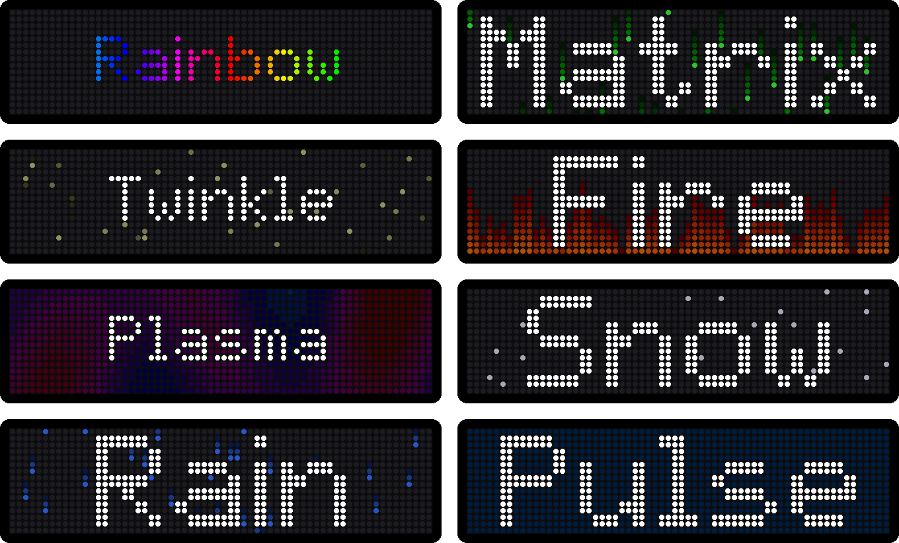
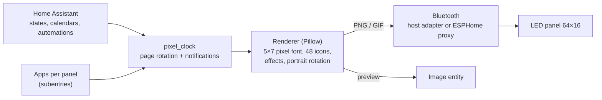

# Pixel Clock for Home Assistant

<p align="center"></p>

Turns a cheap **iPixel Color** Bluetooth LED panel into a smart home display, similar to an
AWTRIX / Ulanzi clock. You decide which pages (apps) it shows – clock, date, weather, any value,
power consumption, a status like "washing machine running", text or appointments – each with a
small icon and an optional animated background effect. Notifications interrupt the rotation.
Landscape or portrait. No cloud, no bridge, no firmware flashing.

[](https://my.home-assistant.io/redirect/hacs_repository/?owner=dominguez-posh&repository=ha-pixelclock&category=integration)

## The hardware

Built and tested with the **"LED flexible fun screen"** (64×16 RGB LEDs, USB powered) from
Action: [Briloner LED-Zeichentablet, article 3226274](https://www.action.com/de-de/p/3226274/briloner-led-zeichentablet/).
It is an iPixel Color panel: Bluetooth name `LED_BLE_…`, vendor app *iPixels*. Other iPixel Color
panels (32×16 … 448×32, e.g. BGLight) speak the same protocol; the size is read from the panel.

## Apps

Every panel has its own list of apps: **Settings → Devices & services → Pixel Clock → Add page**.
Pick the kind of page, then what it shows, an icon, a colour and a background effect. Each app can
be edited or deleted later and has a switch *Page &lt;name&gt;* on the device page. A new panel
starts with clock and date.

<p align="center"></p>

| Kind | Shows | Settings |
|---|---|---|
| **Clock** | big HH:MM with blinking colon, small running seconds, 2 px weekday bar (today highlighted) | seconds, weekday bar |
| **Date** | weekday and date | |
| **Weather** | condition icon and temperature | weather entity |
| **Value** | any entity – temperature, battery, CO₂ … | label, unit, decimals, progress bar (min/max) |
| **Power** | consumption, yellow from 1 kW, red from 3 kW, green with solar icon when feeding in | power sensor |
| **Status** | a page only while something is active, e.g. "washing machine running" | active states or "above value", hold time for pauses, text (templates allowed), progress entity, message when it ends |
| **Text** | fixed text or a template | text |
| **Appointments** | the next appointment from one or more calendars | calendars, days ahead |

The page on screen follows its entity live (at most one update per second). Text that does not
fit scrolls; a line break gives two lines.

### Background effects

<p align="center"></p>

Rainbow text, matrix, twinkling stars, fire, plasma, snow, rain and pulse – seamless loops, kept
dim behind text and icon:

<p align="center"></p>

### Icons

<p align="center"></p>

48 built-in icons, among them washing machine, dishwasher, dryer, plug, lamp, window, lock,
plant, Wi-Fi, music, TV, mail, fan, radiator, EV charging, weather and more – or any
[LaMetric icon](https://developer.lametric.com/icons) by its number (downloaded once, cached), or
an image file from an allowed folder such as `/config/www/`. *Automatic* picks the icon from the
weather condition or the device class.

### Notifications

Notifications (action `pixel_clock.notify`, the *Message* text entity or a status app that ends)
appear within about two seconds:

<p align="center"></p>

### Portrait

Hang the panel upright and pick the matching **Orientation**. Home Assistant then draws on
16×64 (icon on top, wrapped text, text scrolling upwards, stacked clock with seconds, weekday and
date) and rotates the picture before sending it.

<p align="center"></p>

## Requirements

- Home Assistant 2025.3 or newer with the Bluetooth integration
- A **connectable** Bluetooth adapter in range: the host's adapter or an
  [ESPHome Bluetooth proxy](https://esphome.io/components/bluetooth_proxy/)

Home Assistant keeps the connection open, so the iPixels app cannot connect at the same time.
The USB cable only powers the panel (tested: no USB device shows up), so control is Bluetooth only.

## Installation

1. Click the HACS button above, or **HACS → ⋮ → Custom repositories** →
   `https://github.com/dominguez-posh/ha-pixelclock`, type **Integration**.
2. Install **Pixel Clock (iPixel Color)** and restart Home Assistant.
3. The panel shows up under **Settings → Devices & services → Discovered** → **Add**.
4. **Add page** for every app you want; **Configure** (⚙) sets the default text colour.

Updating from 0.1 (pages in the options): the pages, including their on/off state, are turned into
apps automatically.

Manual alternative: copy `custom_components/pixel_clock` into `config/custom_components` and restart.

## Pages from automations (blueprints)

Apps cover most cases. For pages driven by your own automations, import a blueprint, then
**Create automation** from it and choose your entities:

| Blueprint | Import | Example |
|---|---|---|
| **Value as a page** | [](https://my.home-assistant.io/redirect/blueprint_import/?blueprint_url=https%3A%2F%2Fgithub.com%2Fdominguez-posh%2Fha-pixelclock%2Fblob%2Fmain%2Fblueprints%2Fautomation%2Fpixel_clock%2Fvalue_app.yaml) | car battery with bar, room temperature, CO₂ intensity |
| **Page while active** | [](https://my.home-assistant.io/redirect/blueprint_import/?blueprint_url=https%3A%2F%2Fgithub.com%2Fdominguez-posh%2Fha-pixelclock%2Fblob%2Fmain%2Fblueprints%2Fautomation%2Fpixel_clock%2Fstatus_app.yaml) | dishwasher remaining time + progress, car charging |
| **Appliance done** | [](https://my.home-assistant.io/redirect/blueprint_import/?blueprint_url=https%3A%2F%2Fgithub.com%2Fdominguez-posh%2Fha-pixelclock%2Fblob%2Fmain%2Fblueprints%2Fautomation%2Fpixel_clock%2Fappliance_done.yaml) | washing machine on a smart plug |
| **Notification on event** | [](https://my.home-assistant.io/redirect/blueprint_import/?blueprint_url=https%3A%2F%2Fgithub.com%2Fdominguez-posh%2Fha-pixelclock%2Fblob%2Fmain%2Fblueprints%2Fautomation%2Fpixel_clock%2Fevent_notify.yaml) | dishwasher finished, robot bin full, welcome home |
| **Night mode** | [](https://my.home-assistant.io/redirect/blueprint_import/?blueprint_url=https%3A%2F%2Fgithub.com%2Fdominguez-posh%2Fha-pixelclock%2Fblob%2Fmain%2Fblueprints%2Fautomation%2Fpixel_clock%2Fnight_mode.yaml) | 5 % at night, 50 % during the day |

## Entities

| Entity | |
|---|---|
| Light | Power and brightness |
| Switch *Page &lt;name&gt;* | One per app: show it on this panel or not |
| Switch *Automation page &lt;name&gt;* | One per page set by an automation (`pixel_clock.set_app`) |
| Image *Preview* | Live picture of what the panel shows (animated while text scrolls) – put it on a dashboard with a picture entity card |
| Select *Mode* | *Apps* (rotation rendered by Home Assistant) or *Built-in clock* (the panel's own clock face) |
| Select *Orientation* | Landscape, portrait (left or right end on top), upside down |
| Select *Built-in clock face* | Clock face 0–8 for the built-in clock |
| Switch *Rotate apps* | Off: stays on the current page |
| Number *App duration* | Seconds per page (scrolling text gets at least one full pass) |
| Button *Next app* / *Dismiss notification* | |
| Text *Message* | Whatever you type is shown as a notification |
| Sensor *Current app* | Attributes: page list, queued notifications, custom pages |

## Actions

```yaml
# notification, shown right away
action: pixel_clock.notify
data:
  text: "Waschmaschine fertig"
  icon: washer          # built-in name, LaMetric icon id (e.g. 2867) or an image file
  color: [0, 200, 60]
  effect: twinkle       # optional background effect
  duration: 15

# own page in the rotation (templates are rendered by the automation)
action: pixel_clock.set_app
data:
  name: pv
  text: "{{ states('sensor.pv_power') | int }} W"
  icon: solar
  progress: 80          # optional bar 0-100
  lifetime: 3600        # removed when not updated for an hour

action: pixel_clock.remove_app
data:
  name: pv
```

A line break in `text` gives two lines. Text that does not fit scrolls. Without `device_id` the
action goes to all panels.

## How it works



Home Assistant renders every screen itself and uploads it as PNG, or as GIF for scrolling text,
background effects and the clock. A still image is a few hundred bytes, an effect loop 3–17 KB, a
long scrolling text up to ~40 KB. Uploads mostly use writes without response, with an acknowledged
write every 8th packet as flow control and the panel's window acknowledgements as the check; a
40 KB text is on the panel about 2.5 s after the action (Raspberry Pi adapter). Unchanged screens
are not sent again.

The clock with seconds is one GIF that counts to the end of the current minute; it is sent once
per minute (or when the clock comes back after another page), because sending it again restarts
the GIF. The panel keeps its own time as well: it is set on connect and every hour.

Protocol: GATT service `0x00FA`, write `FA02`, notify `FA03`; checked against the iPixels app
3.8.1 and the reverse engineering in [pypixelcolor](https://github.com/lucagoc/pypixelcolor)
(MIT). Details in [`protocol.py`](custom_components/pixel_clock/protocol.py).

## Development

```
python -m venv .venv && .venv/Scripts/pip install pillow pytest bleak pyyaml
.venv/Scripts/python -m pytest tests
.venv/Scripts/python tools/preview.py out/            # render sample screens to files
.venv/Scripts/python tools/docs_images.py             # regenerate the README images
.venv/Scripts/python tools/live_test.py ADDRESS clock # talk to a panel from a PC
```
